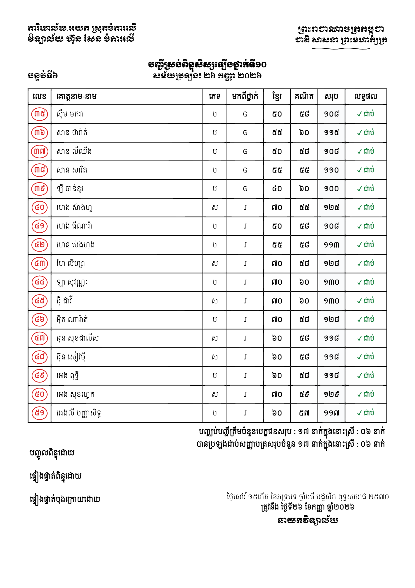

# 🎓 Student Exam System (ប្រព័ន្ធពិនិត្យលទ្ធផលសិស្ស)

> ប្រព័ន្ធពិនិត្យលទ្ធផលសិស្ស និងគូសបន្ទាត់ក្រហមប្រឡងឡើងថ្នាក់ ជាមួយការនាំចេញ Excel & A4 Certificate / Export.


---

## 📸 Preview



---

## ✨ Key Features

- 📑 **Excel / CSV Import & Export** — Supports bulk data import and export using `SheetJS` and `ExcelJS`.
- 🚩 **Cross Red Line Analysis** — Automated evaluation of student scores against pass/fail cutoffs and criteria.
- 🖨️ **A4 Certificate / Result Generation** — High-resolution rendering and export via `html2canvas`.
- 💾 **Config & Template Presets** — Save and restore custom grading parameters and configurations (`saved_template.json`, `saved_features.json`).
- ⚡ **Lightweight & Fast** — Built with vanilla web technologies, requiring minimal setup.

---

## 🛠️ Tech Stack

- **Frontend:** HTML5, CSS3, Vanilla JavaScript (ES6+)
- **Backend:** Node.js (`server.js`)
- **Core Libraries:**
  - [SheetJS (xlsx)](https://sheetjs.com/) — Excel spreadsheet processing
  - [ExcelJS](https://github.com/exceljs/exceljs) — Advanced workbook formatting
  - [html2canvas](https://html2canvas.hertzen.com/) — Screenshot and A4 report rendering

---

## 🚀 Quick Start

### Prerequisites
- [Node.js](https://nodejs.org/) (version 16 or newer installed)

### Running the Application

#### Option A: Quick Launch (Windows)
Double-click [`start-server.bat`](start-server.bat). This will launch the server and open your browser automatically.

#### Option B: Terminal Command
1. Open your terminal in the project directory:
   ```bash
   npm start
   ```
2. Open your browser and navigate to:
   ```text
   http://localhost:3000
   ```

---

## 📁 Repository Overview

```text
├── index.html            # Main UI dashboard and layout
├── style.css             # Interface styling and responsive design
├── script.js             # Client-side score evaluation and logic
├── server.js             # Local Node.js server
├── start-server.bat      # One-click startup script for Windows
├── sample_students.csv   # Example student score dataset for testing
├── saved_template.json   # Default exam template configuration
├── saved_features.json   # Saved custom features and rules
└── Exam_Result_A4.png    # Preview template asset
```

---

## 📖 Usage Guide

1. **Launch the Server:** Run `start-server.bat` or `npm start`.
2. **Import Scores:** Upload student scores using `sample_students.csv` or your custom Excel sheet.
3. **Configure Criteria:** Adjust cutoff thresholds and scoring rules in the dashboard.
4. **Generate & Export:** Review the cross-red-line results and export the reports as Excel or A4 certificates.

---

## 📄 License

This project is licensed under the **ISC License** — see the [package.json](package.json) file for details.
